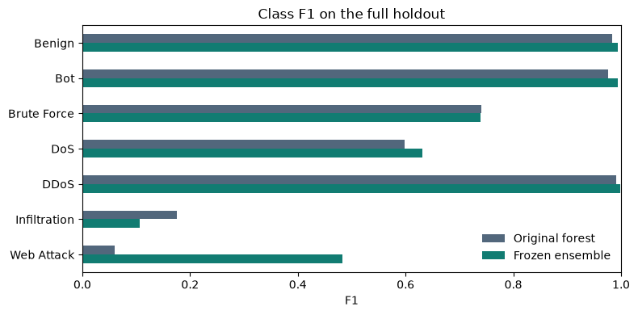

# Multiclass intrusion detection benchmark

The [benchmark notebook](../benchmarking/intrusion_detection_frozen.ipynb) fits the frozen ensemble and the selected classifier-family configurations. It also recomputes the log-byte regression and clustering comparisons. The notebook includes the configuration values, grouped data split, evaluation code, and saved outputs.

## Reproduce the benchmark

1. Put the original CSE-CIC-IDS2018 study archive at `dataset/archive.zip`. Keep it compressed. Use the archive with all ten study captures.
2. In a Python 3.12 environment, install the benchmark packages and JupyterLab from the repository root.

   ```sh
   python -m pip install -r requirements.txt jupyterlab
   ```

3. Open [the notebook](../benchmarking/intrusion_detection_frozen.ipynb) in JupyterLab and run all cells. The full evaluation scores 3,439,552 held-out flows and uses about 520 MB of temporary storage.

## Full held-out comparison

| Metric | Original forest, saved macOS run | Frozen ensemble, saved macOS run | Original forest, results bundle | Frozen ensemble, results bundle |
| --- | ---: | ---: | ---: | ---: |
| Macro-F1 | 0.6466 | 0.7063 | 0.6476 | 0.7137 |
| Accuracy | 95.66% | 97.50% | 95.75% | 97.50% |
| Benign false alerts | 74,969 | 5,636 | 71,910 | 5,487 |

The saved macOS run rebuilt the fixed split and class counts. Some classifier scores differ from the results bundle. The notebook lists the recomputed and reported values for the overall, per-classifier, regression, and clustering comparisons.

The classifier-family results use a shared sample of 63,290 held-out flows. The table above uses the full holdout. The [scores table](scores.csv) includes classifier, regression, and clustering results from the saved notebook run.


